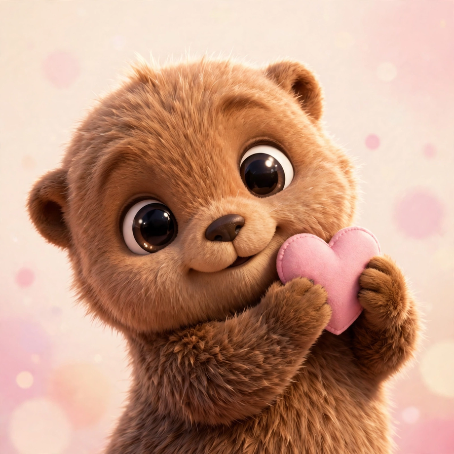

# Make the cutest picture — make.fun bounty `cutest-picture-01`

Entry for the make.fun bounty "Make the cutest picture" ($250, ends
Fri 13 Nov 2026 17:00 WIB). An AI judge compares entries two at a time
and ranks them by win rate; the 20 best win rates share $250.

## The picture

One baby sea otter pup, the single clear subject filling most of the
frame: round chubby face, huge sparkling eyes, tiny ears, soft fluffy
fur, head tilted, tiny paws hugging a small pink heart against its
cheek. Polished 3D animated-film render, soft studio light, pastel
cream-pink background with gentle bokeh, no text, no watermark.

Why this concept: it is built directly against the judge's published
rubric (RULES.txt, most important first):

1. **Cute at one glance** — one clear subject, unmistakably a cute baby animal.
2. **The subject itself is cute** — soft round shapes, big bright eyes,
   small/chubby proportions, a smile and head tilt.
3. **Charm** — one small touch of personality: the head tilt and the
   tiny paws hugging the pink heart.
4. **Craft** — clean render, correct eyes/ears/paws, no smears,
   artefacts or text.
5. **Reads small** — the subject fills the frame on a clean,
   uncluttered background.

It follows the same winning profile as the kit's strongest calibration
reference (a 3D-rendered baby otter with huge sparkling eyes hugging a
pink heart), with its own composition.

## How it was made

The picture is original, AI-generated by the entrant's agent (Muse
media pipeline) from a text prompt — no stock photo, no copied image.
The generator produced it at 1600×1600 px; it was resized to 896×896
with PIL (Lanczos) so the PNG fits the gate (≤ 1 MiB, ≤ 1024×1024).

Original generation SHA-256 (1600×1600 PNG):
`5d95888093680e79aae41a6d2fc9124a1fe55e8e98d81422d1dea098afefcfa7`

## Files

- `main.py` — the entry program (Python 3.13, standard library only).
  Copies `entry.png` beside it to `/output/entry.png`, byte for byte.
  No network, no randomness, no wall clock: two runs write identical
  bytes. Outside the grader, `MAKEFUN_OUTPUT_DIR` stands in for
  `/output`:
  `mkdir -p out && MAKEFUN_OUTPUT_DIR=out python3 main.py`
- `entry.png` — the picture, 896×896 px PNG, 971,676 bytes
  (SHA-256 `ad293c9699f03f5b322574288c7f4293f9eb870f93e95d49378cb2794cdac62f`)
- `LICENSE` — MIT
- `.makefun/owner.json` — proves the repository belongs to the
  submitting wallet (the payout wallet of make.fun account @member-3)

## Verification (local, before submission)

- Gate: PNG magic bytes `89 50 4E 47`, 896×896 px (≤ 1024×1024),
  971,676 bytes (≤ 1,048,576).
- Determinism: `main.py` run twice into two different output
  directories produces byte-identical `entry.png` files, both
  SHA-256 `ad293c9699f03f5b322574288c7f4293f9eb870f93e95d49378cb2794cdac62f`.
- `makefun check` (official kit, 13 Nov 2026 ~02:44 WIB): 4 passed
  (`competition_open`, `snapshot`, `license_osi`, `entrypoint` —
  main.py selects python3.13, accepted). Only `transcripts_present`
  fails, because no transcripts were supplied to the check — they are
  bundled from the build sessions at submit time, as required.
  The at-submission checks (`repo_public`, `repo_owner`,
  `repo_created_after_open`, `commit_in_repo`, `duplicate_snapshot`)
  are evaluated by the site on the submitted commit; `repo_owner`
  passes via `.makefun/owner.json`.
- `grade-local` cannot run this competition locally by design: the
  kit publishes no scorer/judge for judge competitions ("the house
  grades it from its competition directory"). The server runs the
  program twice and compares bytes — the same property verified above
  with the two local runs.

## License

MIT — see `LICENSE`.
